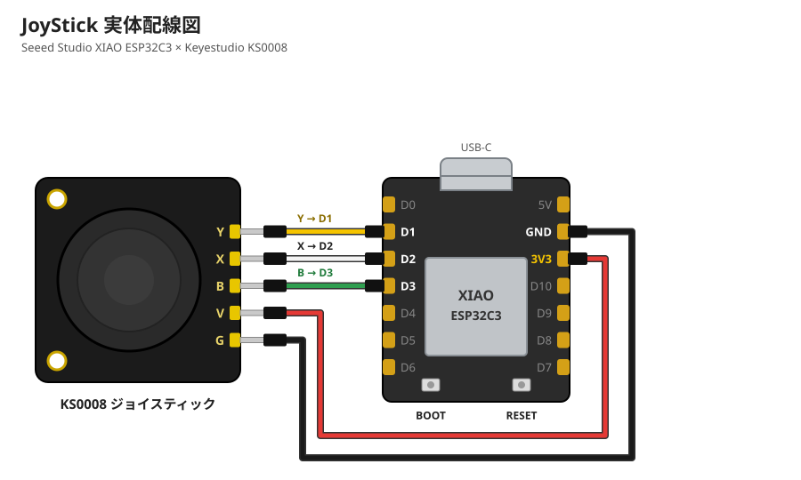

# JoyStick

[Seeed Studio XIAO ESP32C3](https://wiki.seeedstudio.com/XIAO_ESP32C3_Getting_Started/) に Keyestudio KS0008 ジョイスティックモジュールをつなぎ、X/Y の値と押し込みスイッチの状態を USB シリアルと BLE に出力するファームウェアです。

## 必要なもの

| 部品 | 備考 |
|---|---|
| Seeed Studio XIAO ESP32C3 | ピンヘッダをはんだ付けしておく |
| [Keyestudio KS0008 ジョイスティックモジュール](https://docs.keyestudio.com/projects/KS0008/en/latest/docs/KS0008.html) | アナログ出力 X/Y と、押し込みスイッチのデジタル出力。3.3〜5V で動作 |
| ジャンパー線(メス-メス)5 本 | |
| USB Type-C ケーブル | 書き込みと給電 |

## 実体配線図



## 注意点

- **V(電源)は必ず 3V3 につなぐこと。** 5V で給電すると X/Y の出力が最大 5V になり、ESP32-C3 の入力の上限(3.3V)を超えて壊すおそれがあります。
- **X/Y は ADC1 のピン(D0〜D2)につなぐこと。** ESP32-C3 の ADC2(D3)は WiFi/BLE の使用中に値が安定しません。D3 をスイッチ(デジタル入力)に使っているのはこのためです。D0(GPIO2)は起動に関わるピンなので避けています。
- **D8・D9 は使わないこと。** 起動に関わるピンです(D9 は BOOT ボタン)。
- このモジュールの SW は押すと HIGH を出します。ファームウェアで反転しているので、シリアルの `sw` は押すと 0 になります(KS0008 のサンプルスケッチと同じ意味)。

## ビルドと書き込み

PlatformIO を使います。VS Code の PlatformIO 拡張の Build/Upload/Monitor ボタンでも、次のコマンドでも操作できます(PowerShell)。

```
& "$env:USERPROFILE\.platformio\penv\Scripts\pio.exe" run -e xiao-esp32c3 -t upload --upload-port COM8   # ビルドして書き込み
& "$env:USERPROFILE\.platformio\penv\Scripts\pio.exe" device monitor -e xiao-esp32c3 -p COM8          # シリアルモニタ(115200bps)
```

- **ポートは指定すること。** Bluetooth の仮想 COM ポートがある PC では、自動検出でそちらを選んで書き込みに失敗します。XIAO のポートは `pio device list` で `VID:PID=303A:1001` のものです(`COM8` は例)。
- それでも書き込めないときは、BOOT ボタンを押したまま RESET を押してダウンロードモードにしてから書き込みます。

## 動作確認

| 状態 | 期待される表示 |
|---|---|
| スティックを離している | X/Y がそれぞれ中央付近(起動時の校正値) |
| 端まで倒す | 0 または 4095 付近 |
| 押し込む | シリアルの `sw` が 0 |

- シリアルには `x,y,sw` の形式で 1 行ずつ出力します(KS0008 のサンプルスケッチと同じ形式)。BLE(Nordic UART Service、デバイス名 `JoyStick-XIAO`)でも同じ形式で送ります。
- 中央値は起動時に自動で校正し、`# calibrated center: x=… y=…` を出力します。ずれたときはスティックを離した状態で基板の BOOT ボタンを押すか、左右のボタンを同時に 1 秒長押しすると、そのときのスティック位置を中央として校正し直します。

## Fusion の視点操作に使う(JoyOrbit アドイン)

[fusion/JoyOrbit](fusion/JoyOrbit) は、`x,y,sw` を読んで Fusion のビューを回すアドインです。USB で見つからないときは BLE で接続します。

| 操作 | 動き |
|---|---|
| スティックを倒す | 今のモードでビューを動かす |
| SW を短く押す | モードを オービット ⇔ パン で切り替える(今のモードはシリアルに `# mode: orbit` のように出る) |
| SW を長押し(0.8 秒) | ビューをホームに戻す |
| エンコーダを回す | オービットモード: モデルの Z 軸の周りにビューを回す(ターンテーブル)<br>パンモード: ズーム(時計回りで拡大) |
| 左右のボタンを同時に長押し(1 秒) | 今のスティック位置を中央として校正し直す |
| BOOT ボタン | 今のスティック位置を中央として校正し直す |

### 導入

1. XIAO を USB で PC につなぐ(ポートは自動検出)。USB でつながないときは BLE で `JoyStick-XIAO` を探す。
2. Fusion の **ユーティリティ > アドイン > スクリプトとアドイン** を開き、「+」から `fusion/JoyOrbit` フォルダを追加する。
3. 一覧の **JoyOrbit** を実行する(起動時に自動で動かす場合は「起動時に実行」にチェック)。

- 接続状況は Fusion の **テキストコマンド** ウィンドウに `[JoyOrbit] connected: COM8` のように出ます。
- アドイン実行中はシリアルポートを占有するので、`pio device monitor` や書き込みの前にアドインを停止してください。
- 速度・不感帯・向きの反転は [JoyOrbit.py](fusion/JoyOrbit/JoyOrbit.py) 冒頭の設定(`ORBIT_DEG_PER_SEC`、`PAN_PER_SEC`、`DEADZONE`、`SIGN_X`/`SIGN_Y`、`PORT`)で変えられます。同時長押しの時間はファームウェアの `CAL_HOLD_MS` です。
