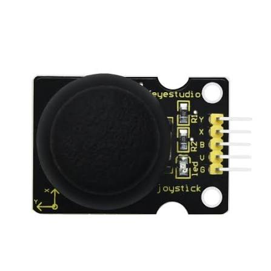
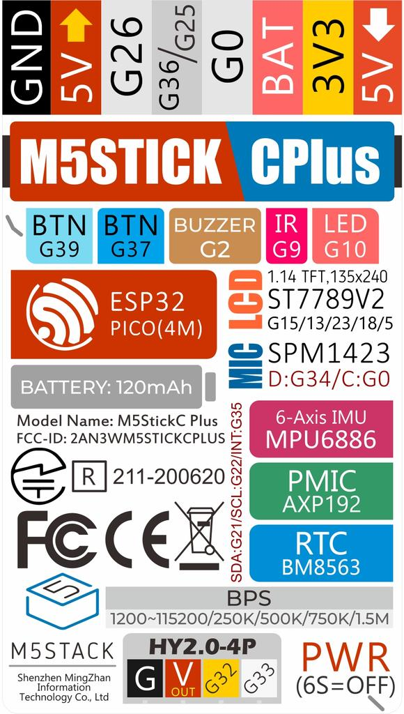

# JoyStick

M5StickC Plus に Keyestudio KS0008 ジョイスティックモジュールをつなぎ、X/Y の値と押し込みスイッチの状態を画面とシリアルに表示するファームウェアです。

## 必要なもの

| 部品 | 備考 |
|---|---|
| M5StickC Plus | |
| [Keyestudio KS0008 ジョイスティックモジュール](https://docs.keyestudio.com/projects/KS0008/en/latest/docs/KS0008.html) | アナログ出力 X/Y と、押し込みスイッチのデジタル出力。3.3〜5V で動作 |
| Grove⇔ジャンパー変換ケーブル | 本体下の Grove ポートにつなぐため |
| ジャンパー線(メス) | 本体上の端子列にそのまま差せる |

## 接続表



KS0008 の端子は上から `Y / X / B / V / G` の順に並んでいます。

| KS0008 の端子 | 意味 | M5StickC Plus 側 | 場所 |
|---|---|---|---|
| Y | Y 軸(アナログ) | G32 | 下の Grove ポート |
| X | X 軸(アナログ) | G33 | 下の Grove ポート |
| B | 押し込みスイッチ | G26 | 上の端子列 |
| V | 電源 | **3V3** | 上の端子列 |
| G | GND | GND | 上の端子列(Grove の黒線でも可) |

### 下の Grove ポート

| 線の色 | 信号 | KS0008 の端子 |
|---|---|---|
| 黒 | GND | G(上の端子列の GND でも可) |
| 赤 | 5V | **使わない**。先端をテープで絶縁しておく |
| 黄 | G32 | Y |
| 白 | G33 | X |

### 上の端子列(8ピン)

ケース背面のラベルを正面から見たときの並び順は、左から次のとおりです(画面側から見ると左右が逆になります)。

```
GND / 5V / G26 / G36(G25) / G0 / BAT / 3V3 / 5V
```

KS0008 の B は G26、V は 3V3 に差します。

### M5StickC Plus のピン配置ラベル



## 注意点

- **V(電源)は必ず 3V3 につなぐこと。** 5V で給電すると X/Y の出力が最大 5V になり、ESP32 の入力の上限(3.3V)を超えて本体を壊すおそれがあります。
- **X/Y は ADC1 のピン(G32/G33/G36)につなぐこと。** ADC2 のピン(G26 など)は WiFi の使用中にアナログ値を読めません。G26 をスイッチ(デジタル入力)に使っているのはこのためです。
- **G0 は使わないこと。** 起動に関わるピンです。
- このモジュールの SW は押すと HIGH を出します。ファームウェアで反転しているので、シリアルの `sw` は押すと 0 になります(KS0008 のサンプルスケッチと同じ意味)。

## ビルドと書き込み

PlatformIO を使います。VS Code の PlatformIO 拡張の Build/Upload/Monitor ボタンでも、次のコマンドでも操作できます(PowerShell)。

```
& "$env:USERPROFILE\.platformio\penv\Scripts\pio.exe" run -t upload    # ビルドして書き込み
& "$env:USERPROFILE\.platformio\penv\Scripts\pio.exe" device monitor   # シリアルモニタ(115200bps)
```

## 動作確認

| 状態 | 期待される表示 |
|---|---|
| スティックを離している | X/Y がそれぞれ約 2048 |
| 端まで倒す | 0 または 4095 付近 |
| 押し込む | 画面に `SW: PRESSED`、シリアルの `sw` が 0 |

- 中央値は起動時に自動で校正します。ずれたときはスティックを離した状態で本体のボタン A を押すと、校正し直します。
- シリアルには `x,y,sw` の形式で 1 行ずつ出力します(KS0008 のサンプルスケッチと同じ形式)。
